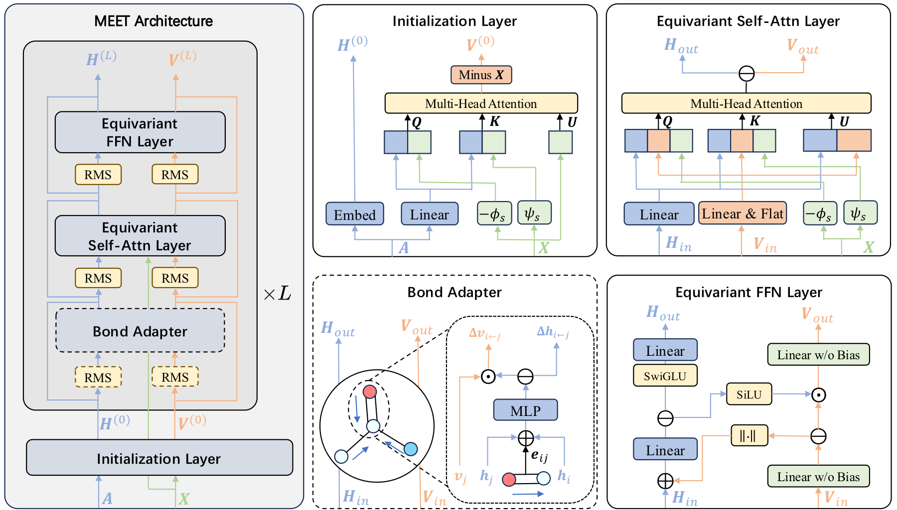

# Scalable Peptide Design via Memory-Efficient Equivariant Transformer

<p align="center">
  
</p>

MEET is a memory-efficient equivariant Transformer backbone for full-atom peptide design. This repository provides the training, generation, and evaluation code for a two-stage latent generative pipeline in which an atom-level VAE compresses peptide--pocket complexes into block-level latent variables, and a conditional latent diffusion model generates peptide latents from protein pocket context before decoding them back to full-atom structures.

## Repository Layout

```text
.
├── configs
│   ├── AtomVAE              # VAE training configs
│   ├── LatentGenHX          # latent diffusion training configs
│   └── test                 # generation and evaluation configs
├── data                     # dataset definitions and molecular parsing utilities
├── evaluations              # metric runners and evaluation task definitions
├── models
│   ├── AtomVAE              # atom-level VAE
│   ├── LatentGenHX          # latent diffusion generator
│   └── modules              # MEET and generative building blocks
├── scripts                  # training and preprocessing scripts
├── trainer                  # training loops and logging utilities
├── generate.py              # structure generation entry point
├── eval.py                  # evaluation entry point
└── train.py                 # training entry point
```

## Installation

The recommended environment is specified in `env_cuda128.yaml`. Create the conda environment with:

```bash
conda env create -f env_cuda128.yaml
conda activate unimomo_meet
```

Note that `swanlab` is an optional experiment logger. If it is not needed, set `trainer.config.logger` to `tensorboard` or `wandb` in the training config.

## Data

The released configs expect processed datasets under `./dataset`:

```text
dataset
├── train_100K
├── train_1p2M
├── valid
└── test
```

For example, `configs/LatentGenHX/train_1p2M_base.yaml` reads from `./dataset/train_1p2M` and `./dataset/valid`. If your data is stored elsewhere, update `dataset.train.mmap_dir` and `dataset.valid.mmap_dir` in the corresponding YAML file. The processed datasets can be downloaded [here](https://zenodo.org/records/20762128).

## Checkpoints

Pretrained checkpoints are provided [here](https://zenodo.org/records/20746712)

The 1.2M LDM checkpoints cover the MEET-XS, MEET-S, MEET-B, and MEET-L model scales.

| Model | Layers | Hidden size | Heads | VAE params | LDM params |
|---|---:|---:|---:|---:|---:|
| MEET-XS | 6 | 384 | 6 | 11.9M | 48.4M |
| MEET-S | 12 | 384 | 6 | 11.9M | 84.0M |
| MEET-B | 12 | 768 | 12 | 11.9M | 300.4M |
| MEET-L | 24 | 1024 | 16 | 11.9M | 1.0B |

After downloading, please place pretrained checkpoints under `./ckpt` using the same directory structure referenced by the configs:

```text
ckpt
└── 1p2M
    ├── vae
    │   └── vae_default_ls01_epoch85_step100000.ckpt
    └── ldm
        ├── mini
        │   └── epoch85_step100000.ckpt
        ├── small
        │   └── epoch85_step100000.ckpt
        ├── base
        │   └── epoch85_step100000.ckpt
        └── large
            └── epoch85_step200000.ckpt
```

## Training

Training is launched through `scripts/train.sh`, which wraps `train.py` and handles single-GPU, multi-GPU, and multi-node execution through environment variables.

### Train the VAE

```bash
export TORCH_ALLOW_TF32_CUBLAS_OVERRIDE=1
GPU=0,1,2,3,4,5,6,7 bash scripts/train.sh configs/AtomVAE/train_1p2M_vae.yaml
```

VAE training configs:

```text
configs/AtomVAE/train_100k_vae.yaml
configs/AtomVAE/train_1p2M_vae.yaml
```

### Train the Latent Diffusion Model

After a VAE checkpoint is available, train one of the latent diffusion variants:

```bash
export TORCH_ALLOW_TF32_CUBLAS_OVERRIDE=1
GPU=0,1,2,3,4,5,6,7 bash scripts/train.sh configs/LatentGenHX/train_1p2M_base.yaml
```

LDM training configs:

```text
configs/LatentGenHX/train_100k_mini.yaml
configs/LatentGenHX/train_100k_base.yaml
configs/LatentGenHX/train_1p2M_mini.yaml
configs/LatentGenHX/train_1p2M_small.yaml
configs/LatentGenHX/train_1p2M_base.yaml
configs/LatentGenHX/train_1p2M_large.yaml
```

For multi-node training, set `NNODE`, `NODE_RANK`, `ADDR`, and `PORT` before launching `scripts/train.sh`.

## Generation

Generation uses configs from `configs/test` and writes references, candidates, and metadata under the specified output directory.

### VAE Generation

```bash
CUDA_VISIBLE_DEVICES=0 python generate.py \
  --config configs/test/test_vae.yaml \
  --model_config configs/AtomVAE/train_1p2M_vae.yaml \
  --ckpt ./ckpt/1p2M/vae/vae_default_ls01_epoch85_step100000.ckpt \
  --save_dir ./outputs/vae
```

### Latent Diffusion Generation

```bash
CUDA_VISIBLE_DEVICES=0 python generate.py \
  --config configs/test/test_latentgen.yaml \
  --model_config configs/LatentGenHX/train_1p2M_base.yaml \
  --ckpt ./ckpt/1p2M/ldm/base/epoch85_step100000.ckpt \
  --save_dir ./outputs/latentgen
```

`--model_config` points at the training config used to build the model; the
checkpoint's `state_dict` is then loaded into a freshly constructed model (see
`utils/checkpoint.py`). Pass the config matching the checkpoint's scale
(`train_1p2M_{mini,small,base,large}.yaml`).

The generator creates one subdirectory per pocket definition, such as `pocket_dist_20`, and stores generated structures under `candidates`.

## Evaluation

Evaluate generated structures with the matching metric configuration:

```bash
python eval.py \
  --root_dir ./outputs/vae \
  --eval_config configs/test/eval_metrics_vae.yaml \
  --num_workers 16

python eval.py \
  --root_dir ./outputs/latentgen \
  --eval_config configs/test/eval_metrics_latentgen.yaml \
  --num_workers 16
```

Evaluation results are written to `eval_results.json` inside each generated result directory.

## Notes

- YAML values can be overridden from the command line through the optional arguments passed to `train.py` or `generate.py`.
- The MEET backbone (`models/modules/MEET`) and the generative modeling utilities (`models/modules/generative`) can also be used as standalone packages. Each module contains a self-contained README, and you are welcome to use and explore them independently.


## Contact

For questions, please contact:

Rui Jiao: vinceayin@gmail.com
